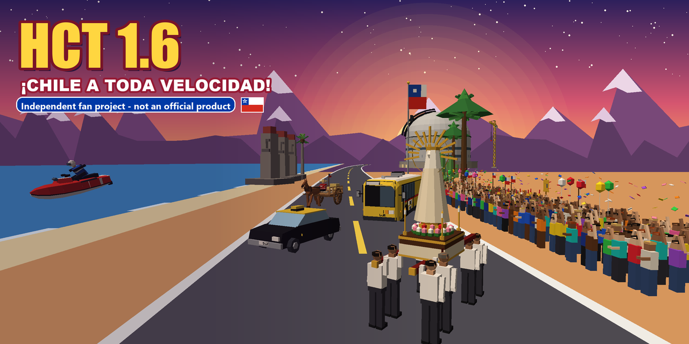

# HCT 1.6 - a Chilean fan mod for Horizon Chase Turbo

**Version 2.3.9.** A free, non-commercial fan mod for Horizon Chase Turbo (PC, Steam). It runs on top of the original game **without changing it**: it is loaded by BepInEx and removed with one click.

> **FULLY VIBECODED - WE NEED YOUR HELP IN REFINING IT.** Everything in this mod - the code, the tracks, models, textures, sounds, texts, voices and music - was made with AI (Claude, by Anthropic) from one player's directions in plain language and from open map data. Nobody wrote or reviewed the code by hand. It works and has been played a lot, but expect rough edges. Play it and [report what is wrong](https://github.com/irregbex/hct16-chile-mod/issues), suggest improvements, or send fixes and new tracks as pull requests.

This repository contains **no file of the game**. You need your own copy of Horizon Chase Turbo, bought on Steam. Horizon Chase Turbo belongs to Aquiris Game Studio; this mod is not affiliated with or endorsed by Aquiris.

## Trailer

Version 2.3.5, 1:47, split-screen for up to 4 players: https://youtu.be/x8EvNXgQcAc

## Download and install

1. Go to **[Releases](https://github.com/irregbex/hct16-chile-mod/releases/latest)** and download **HCT16-&lt;version&gt;-Installer.zip**.
2. Unzip it anywhere, close the game and double-click **INSTALL.cmd** (it finds the game in your Steam libraries).
3. Start Horizon Chase Turbo from Steam as usual. The title screen shows "HCT 1.6 ... MOD ACTIVE".

To remove it: **UNINSTALL.cmd** from the same folder.

## What it adds

- **Five campaigns:**
  - **Chile:** 164 races through Chilean cities and the comunas of Santiago, from Arica and the altiplano to the glaciers of Aysén, Tierra del Fuego and Antarctica - observatories (a lap round and inside the Extremely Large Telescope), ski centres, volcanoes, Easter Island, beaches on jet skis, the procession of andas round the Plaza de Illapel, a Santiago flooded by a thunderstorm. A map of Chile to pick the region and the place.
  - **Rutas de Chile:** point-to-point stages along real roads (Ruta 68, Ruta 47 on a horse cart, the Valparaíso coast, Villarrica - Pucón, Coyhaique - Aysén...).
  - **Aventura Chile:** challenges with the mod's own vehicles.
  - **Competencia Chile 2026:** 40 races in 8 cups.
  - **Grand Prix 2026:** a fictional season with the game's formula cars (needs the "Senna Forever" DLC).
- **Vehicles of its own:**
  - a Chilean taxi;
  - the yellow "micro" bus (8 routes);
  - horse carts (11);
  - jet skis (8);
  - procession andas carried by eight bearers (6 images).
- **Split-screen for up to 4 players**, each in a different vehicle.
- **A live 3D podium ceremony** after every race of these campaigns:
  - the top three arrive on stage and each vehicle's own driver gets off for the cup;
  - presenters, flashes, confetti, fireworks and a crowd waving Chilean flags;
  - Costanera Center and La Moneda behind the Santiago stages.
- **Chilean voices:** rivals that taunt you in Chilean slang, with speech bubbles.
- **Weather and time of day** per track, nights with lights and fireworks.
- **The mod's own songs** (made with AI too), and your own music if you add it.
- **A browser track editor:** HCT16-Track-Editor.zip in Releases.

The tracks were built from open data: OpenStreetMap streets and buildings, SRTM terrain and Sentinel-2 imagery.

## We're recruiting

We are looking for **graphic designers, 3D modelers, track designers and music composers**. Paid work is possible, and your name goes in the mod's credits. Interested? [Open an issue](https://github.com/irregbex/hct16-chile-mod/issues).

## More

- **[README.txt](README.txt):** the full guide - how to play, your music, the track editor, building from source, development.
- **[CHANGELOG.txt](CHANGELOG.txt):** what changed in each version.
- **[CREDITS.txt](CREDITS.txt)** and **[LICENSE.txt](LICENSE.txt):** the code is MIT; the content follows the licences of its open data (OpenStreetMap ODbL, Sentinel-2 CC BY-NC-SA, non-commercial).

The drivers' lines contain strong Chilean slang and swearing.
